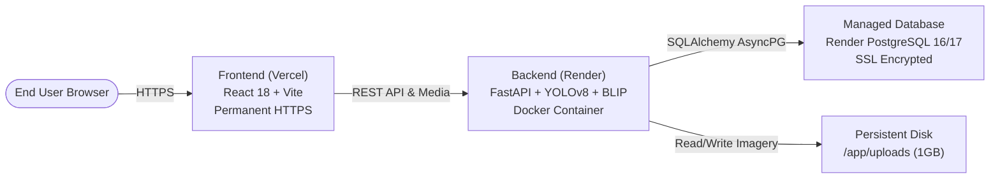

# Production Cloud Deployment Guide

## BEL Conversational Image Recognition Chatbot

This document details the production deployment architecture and step-by-step instructions for deploying the application to the internet with permanent public HTTPS URLs.

---

## 1. Deployment Architecture



---

## 2. Part 1: Backend & Database Deployment (Render)

The repository includes a ready-to-use `render.yaml` Blueprint that automatically provisions:
1. **Managed PostgreSQL Database**: `bel-postgres` (`bel_chatbot_db`).
2. **FastAPI Web Service**: `bel-chatbot-api` running Python 3.11 with pre-cached model weights (`yolov8s.pt` and `Salesforce/blip-vqa-base`).
3. **Persistent Disk**: 1GB mounted at `/app/uploads` ensuring uploaded imagery is preserved across restarts.

### Deployment Steps:
1. Log in to [Render Dashboard](https://dashboard.render.com).
2. Click **Blueprints** -> **New Blueprint Instance**.
3. Connect your GitHub repository:
   `https://github.com/vineetbhati-18/conversational-image-recognition-chatbot`
4. Render will detect `render.yaml` and display the blueprint resources:
   - `bel-postgres` (Database)
   - `bel-chatbot-api` (Web Service)
   - `uploads` (Persistent Disk)
5. Click **Apply**.
6. Render builds the Docker container, caches YOLO and BLIP weights during image build, mounts the disk, runs schema migrations automatically, and provisions your public HTTPS backend URL:
   `https://bel-chatbot-api.onrender.com`

### Production Health Check:
```bash
curl -s https://<your-render-url>.onrender.com/api/v1/health
```
Expected response:
```json
{
  "status": "healthy",
  "app": "BEL Conversational Image Recognition Backend",
  "version": "1.0.0",
  "database": {"status": "connected"},
  "acceleration": {"active_device": "cpu"}
}
```

---

## 3. Part 2: Frontend Deployment (Vercel)

The frontend is built with React 18, Vite, and Tailwind CSS.

### Deployment Steps:
1. Log in to [Vercel Dashboard](https://vercel.com/dashboard).
2. Click **Add New...** -> **Project**.
3. Import the repository:
   `https://github.com/vineetbhati-18/conversational-image-recognition-chatbot`
4. Configure Project Settings:
   - **Framework Preset**: `Vite`
   - **Root Directory**: `frontend` (or leave default root, both are supported via `vercel.json`).
   - **Build Command**: `npm run build`
   - **Output Directory**: `dist`
5. Add Environment Variables:
   | Key | Value |
   |---|---|
   | `VITE_API_BASE_URL` | `https://<your-render-url>.onrender.com/api/v1` |
   | `VITE_BACKEND_URL` | `https://<your-render-url>.onrender.com` |
6. Click **Deploy**.
7. Vercel compiles the production bundle in under 1 minute and provisions your permanent public HTTPS URL:
   `https://conversational-image-recognition-chatbot.vercel.app`

---

## 4. Part 3: Environment Variables Matrix

### Backend (`Render`):
- `DATABASE_URL`: Automatically linked from Render PostgreSQL via `render.yaml`.
- `CORS_ORIGINS`: `https://*.vercel.app,http://localhost:5173,*`
- `UPLOAD_DIR`: `/app/uploads`
- `DEVICE_OVERRIDE`: `cpu`
- `PORT`: Automatically set by Render.

### Frontend (`Vercel`):
- `VITE_API_BASE_URL`: `https://<your-render-url>.onrender.com/api/v1`
- `VITE_BACKEND_URL`: `https://<your-render-url>.onrender.com`

---

## 5. Verification Checklist

- [x] Backend Dockerfile pre-caches YOLO and BLIP model weights during build to prevent cold-start download timeouts.
- [x] Dynamic `$PORT` handling configured for cloud container orchestration.
- [x] Database URL automatically normalizes cloud connection strings (`postgres://` -> `postgresql+asyncpg://`).
- [x] CORS middleware explicitly allows all Vercel production and preview deployments (`https://.*\.vercel\.app`).
- [x] Frontend `resolveMediaUrl` ensures uploaded image paths resolve to the live Render backend.
- [x] Multi-turn dialogue history, YOLO detections, bounding boxes, and session restoration verified end-to-end.
